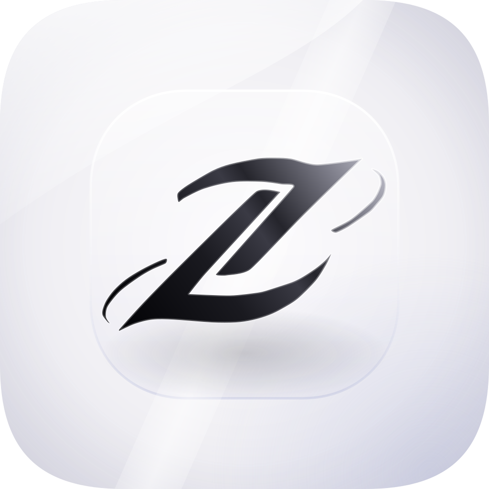

 

<h1>Zenith</h1>

<b>A YouTube Music player for Android with an Apple Music–style interface</b>

<a href="#screenshots">Screenshots</a> ·
<a href="#highlights">Highlights</a> ·
<a href="#download">Download</a> ·
<a href="#features">Features</a> ·
<a href="#whats-different-from-bitchord">What's different</a> ·
<a href="#community">Community</a> ·
<a href="#credits">Credits</a>

> [!IMPORTANT]
> Zenith is not affiliated with, endorsed by, or connected to YouTube or Google in any way. Use it at your own discretion.

> [!NOTE]
> **A note from the developer:** Zenith is built entirely on my phone. I don't have a laptop or PC of my own, so every line of code, every build and every release is done from mobile. It's slow and sometimes painful, so please bear with me if you run into bugs or rough edges. If something is broken or missing, please [open an issue](../../issues). Thank you for using Zenith!

---

## Screenshots

<table>
  <tr>
    <td align="center" width="33%"> <b>Home</b></td>
    <td align="center" width="33%"> <b>Explore</b></td>
    <td align="center" width="33%"> <b>Library</b></td>
  </tr>
  <tr>
    <td align="center" width="33%"> <b>Liked Music</b></td>
    <td align="center" width="33%"> <b>Player</b></td>
    <td align="center" width="33%"></td>
  </tr>
</table>

---

## Highlights

| Area | What you get |
| --- | --- |
| **Player** | Mini and big player move as one panel, with covers that fly between screens and a full-screen animated canvas. |
| **Home and Library** | Top Picks, Made for You Mix, Most Played, and a Liked Music hero in the style of Apple Music. |
| **Lyrics** | Word-by-word highlighting with a new engine and the LiquidFlow effect. |
| **Automix** | Beat-matched transitions with better tempo and cue detection. |
| **Look** | Liquid Glass controls, a lighter Frosted Glass mode, and 10 accent colors. |
| **Queue** | Apple Music–style queue with an Add Songs popup and live search. |
| **Offline** | Downloads, animated covers and browse data stay available without a connection. |
| **Speed** | Disk caching and sensible first-run defaults for quicker loading. |
| **Album pages** | Apple Music–style layout with genre and year, an inline MORE on the description, and a footer with the full release date, song count, runtime and ℗ line. |

---

## Download

1. Open the [latest release](https://github.com/rezapranata089-bit/Zenith/releases/latest).
2. Download the APK file.
3. Open it and allow "Install unknown apps" if Android asks.

| | |
| --- | --- |
| **Android** | 8.0 or newer |
| **Architecture** | arm64 |
| **Updates** | Checked inside the app |

Past versions and their changes are listed in [Releases](https://github.com/rezapranata089-bit/Zenith/releases).

---

## Features

<b>Playback</b>

- Search, browse and play anything on YouTube Music.
- Hi-Res lossless audio (FLAC/ALAC) from a configured module source, with YouTube Music as fallback.
- Gapless playback with true crossfade, adjustable from 0 to 12 seconds.
- Automix (Beta): DJ-style transitions with beat-matching and tempo-stretching.
- Offline downloads with embedded metadata, and a local music library.
- Bit-perfect USB output to a USB DAC at each track's own sample rate and bit depth. Thanks to [Mornye](https://github.com/mornyeapp/Mornye) for the reference.

<b>Look and feel</b>

- Apple Music style with squircle shapes and a choice of accent colors.
- Liquid Glass controls, plus a lighter Frosted Glass mode.
- Mini player and big player share one panel, and covers fly between screens.
- Animated album canvas and a theme that follows the album artwork.
- Album pages in the Apple Music style: genre and year under the title, a compact description, clean track rows, and a footer with release date, song count, runtime and copyright line (looked up from the iTunes catalogue).

<b>Lyrics</b>

- Word-synced lyrics with the MOTION engine and the LiquidFlow effect.
- Apple Music–style lyrics animation, credit to [binimum](https://github.com/binimum/am-lyrics).
- Providers: [lrc.red](https://lrc.red), [BiniLyrics](https://github.com/binimum), [BetterLyrics](https://github.com/better-lyrics/better-lyrics), [PaxSenix](https://lyrics.paxsenix.org), [LyricsPlus](https://github.com/ibratabian17/YouLyPlus), [SimpMusic](https://github.com/maxrave-dev/SimpMusic), [Unison](https://unison.boidu.dev), [Megalobiz](https://www.megalobiz.com), [KuGou](https://www.kugou.com), [LRCLIB](https://lrclib.net), [Musixmatch](https://www.musixmatch.com) and [Genius](https://genius.com).

<b>Accounts and connections</b>

- Sign in with Google for personalized content.
- Spotify integration for your playlists and Liked Songs.
- Discord Rich Presence, plus scrobbling to Last.fm and ListenBrainz.
- Listen Together for listening in sync with friends.
- Pluggable module sources you can add, edit and test.

<b>Controls</b>

- Separate audio quality for Wi-Fi and mobile data.
- Playback speed from 0.5× to 2.0×, skip silence, sleep timer and system equalizer.
- Stats for nerds: codec, bit depth and sample rate on the player screen.

---

## What's different from BitChord

Zenith is my personal fork of [BitChord](https://github.com/kushagrasinghx/BitChord), rebuilt as an Android-only app with its own identity, interface and release pipeline.

---

## Community

Join the discussion, share feedback or ask for help on [r/ZenithMusic](https://www.reddit.com/r/ZenithMusic/s/gN6chb7onR). Bug reports and feature requests are still welcome as [GitHub issues](../../issues).

---

## Credits

Zenith is built on top of [BitChord](https://github.com/kushagrasinghx/BitChord) by [kushagrasinghx](https://github.com/kushagrasinghx) and its contributors. Thank you for the foundation.

---

## Disclaimer

<b>Legal notice</b>

Zenith is an independent third-party audio player. It is **not** associated with Google LLC, YouTube Music, Deezer, Telegram, or any of their parent companies.

- **No media hosting**: Zenith does not host or upload copyrighted music. It only acts as an interface to local storage or to public and user-authenticated APIs.
- **Fair use**: made for personal, research and educational purposes. You are responsible for following your local copyright laws and the YouTube Terms of Service.
- **No guarantees**: features may stop working if third-party platforms change their rules.

## License

Licensed under the **GNU GPL v3.0**. See [LICENSE](LICENSE). Anyone distributing copies must provide the source code under the same license.
