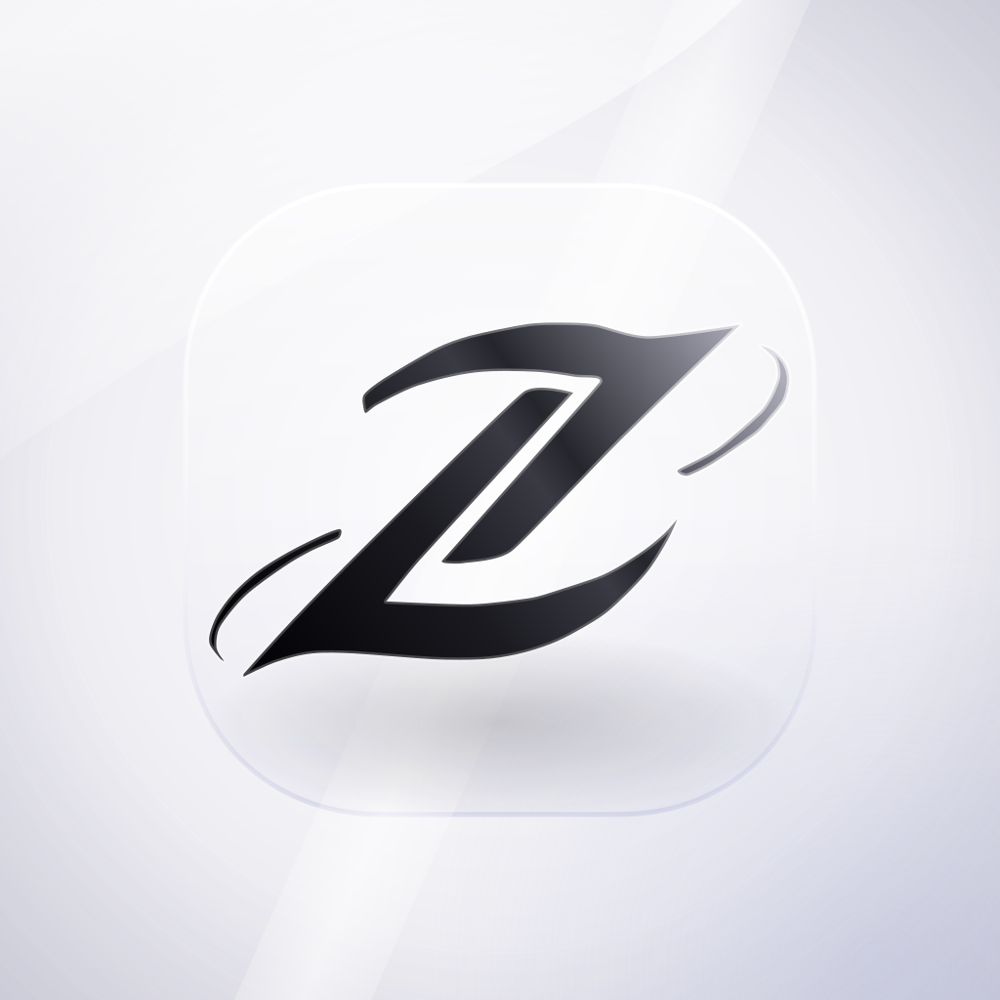
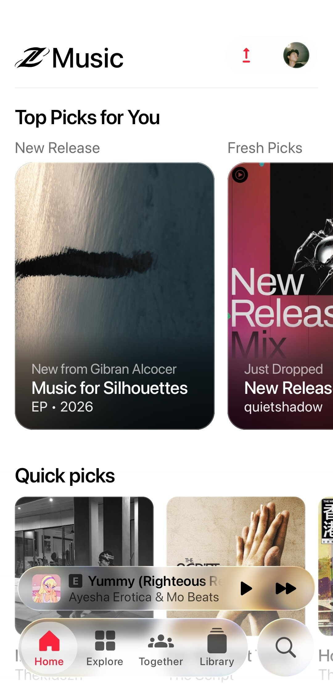
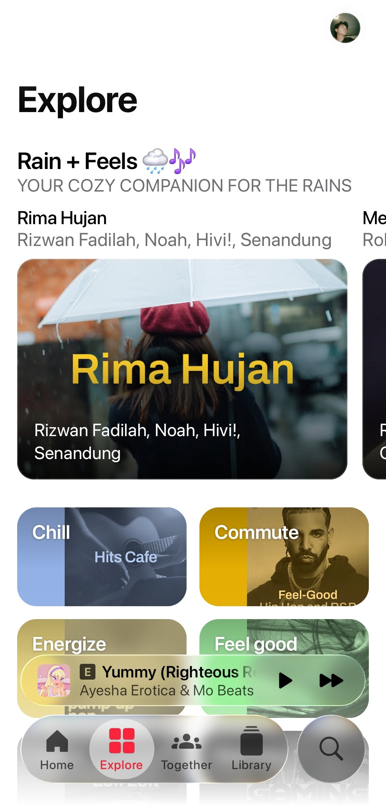
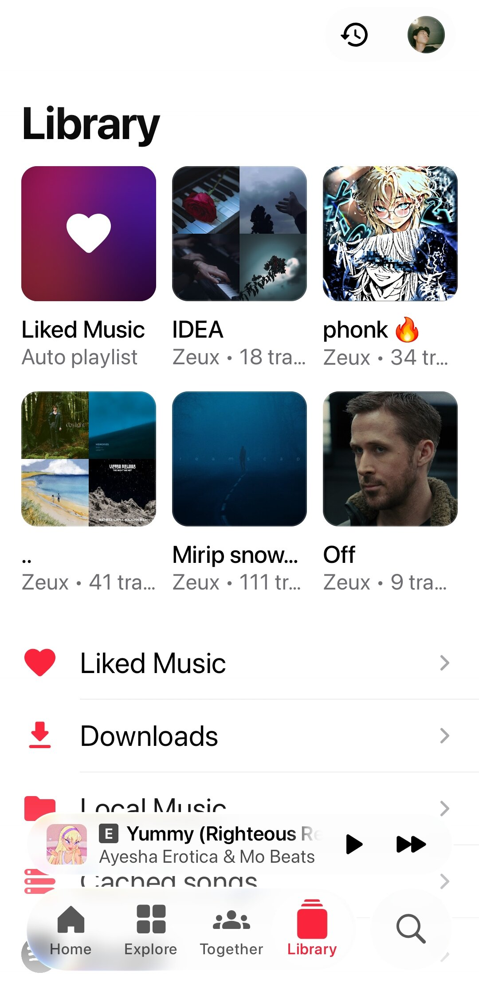
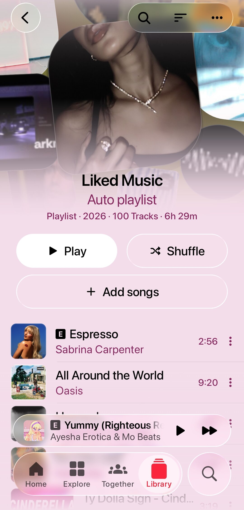
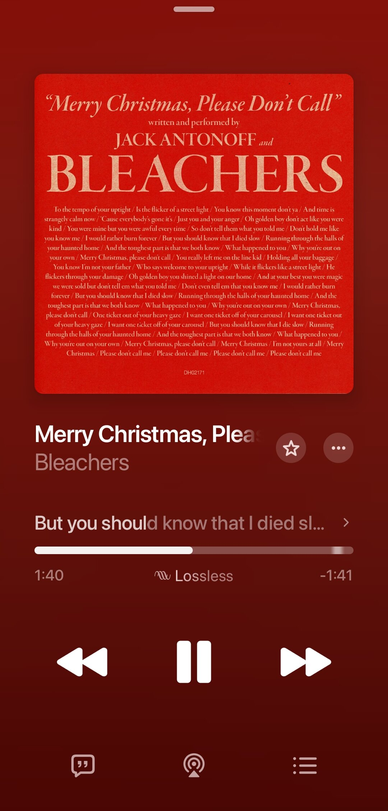

 

<h1>Zenith</h1>

<b>An Apple Music–style YouTube Music player for Android</b> Zeuxxi Edition

<a href="#download">Download</a> ·
<a href="#features">Features</a> ·
<a href="#whats-different-from-bitchord">What's different</a> ·
<a href="#credits">Credits</a> ·
<a href="#disclaimer">Disclaimer</a>

> [!IMPORTANT]
> Zenith is not affiliated with, endorsed by, or connected to YouTube or Google in any way. Use it at your own discretion.

---

## Download

Grab the latest APK from the [Releases](https://github.com/rezapranata089-bit/Zenith/releases) page. Zenith is Android only (arm64). When installing from a file, allow "Install unknown apps" for the app you open the APK with.

The full changelog is in [RELEASE_NOTES.md](RELEASE_NOTES.md).

---

## Screenshots

---

## Features

### Playback
- Search, browse and play anything on YouTube Music.
- Hi-Res lossless audio (FLAC/ALAC) from a configured module source, with YouTube Music as fallback.
- Gapless playback with true crossfade, adjustable from 0 to 12 seconds.
- Automix (Beta): DJ-style transitions with beat-matching and tempo-stretching.
- Offline downloads with embedded metadata.
- Local music library and background playback through a proper media session.
- Bit-perfect USB output to a USB DAC at each track's own sample rate and bit depth. Thanks to [Mornye](https://github.com/mornyeapp/Mornye) for the reference.

### Look and feel
- Apple Music style: squircle shapes, a choice of accent colors, Liquid Glass and a lighter Frosted Glass mode.
- Mini player and big player share one morphing panel, and covers fly between screens.
- Animated album canvas on the player screen.
- Dynamic theme taken from the album artwork.

### Lyrics
- Word-synced lyrics with the MOTION engine and the LiquidFlow effect.
- Apple Music–style lyrics animation, credit to [binimum](https://github.com/binimum/am-lyrics).
- Lyrics providers: [lrc.red](https://lrc.red), [BiniLyrics](https://github.com/binimum), [BetterLyrics](https://github.com/better-lyrics/better-lyrics), [PaxSenix](https://lyrics.paxsenix.org), [LyricsPlus](https://github.com/ibratabian17/YouLyPlus), [SimpMusic](https://github.com/maxrave-dev/SimpMusic), [Unison](https://unison.boidu.dev), [Megalobiz](https://www.megalobiz.com), [KuGou](https://www.kugou.com), [LRCLIB](https://lrclib.net), [Musixmatch](https://www.musixmatch.com) and [Genius](https://genius.com).

### Accounts and connections
- Sign in with Google for personalized content.
- Spotify integration for your playlists and Liked Songs.
- Discord Rich Presence, plus scrobbling to Last.fm and ListenBrainz.
- Listen Together for listening in sync with friends.
- Pluggable module sources you can add, edit and test.

### Controls
- Separate audio quality for Wi-Fi and mobile data.
- Playback speed from 0.5× to 2.0×, skip silence, sleep timer and system equalizer.
- Stats for nerds: codec, bit depth and sample rate on the player screen.

---

## What's different from BitChord

Zenith is my personal fork of [BitChord](https://github.com/kushagrasinghx/BitChord). What changed:

- **Own identity**: renamed to Zenith, new Z icon, package `com.zeux.zenith`, downloads saved to `Music/Zenith`.
- **Android only**: TV, web, backend, desktop and Wear OS code removed, APK built for arm64-v8a only.
- **Apple Music–style UI**: new color scheme, 10 accent colors, glass toggles, sliders and segmented controls.
- **New player**: one panel that morphs from mini to full, full-screen canvas, cover transitions between songs.
- **New Home and Library**: Top Picks cards, Made for You Mix, Most Played, Liked Music hero.
- **More precise Automix**: beat-phase correction, better tempo and cue detection.
- **Caching and speed**: disk cache for browse, lyrics and search, first-run presets with a fallback for low-RAM phones.
- **Automated releases**: GitHub Actions builds a signed APK whenever a `v*` tag is pushed, and the in-app updater checks this repository.

---

## Credits

Zenith is built on top of [BitChord](https://github.com/kushagrasinghx/BitChord) by [kushagrasinghx](https://github.com/kushagrasinghx) and its contributors. Thank you for the foundation.

---

## Disclaimer

Zenith is an independent third-party audio player. It is **not** associated with Google LLC, YouTube Music, Deezer, Telegram, or any of their parent companies.

- **No media hosting**: Zenith does not host or upload copyrighted music. It only acts as an interface to local storage or to public and user-authenticated APIs.
- **Fair use**: made for personal, research and educational purposes. You are responsible for following your local copyright laws and the YouTube Terms of Service.
- **No guarantees**: features may stop working if third-party platforms change their rules.

## License

This project is licensed under the **GNU GPL v3.0**. See the [LICENSE](LICENSE) file. Anyone distributing copies must provide the source code under the same license.
