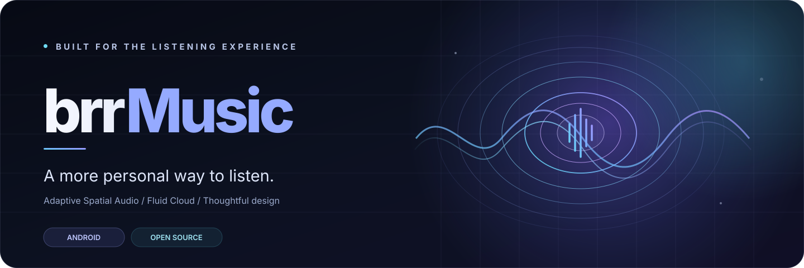
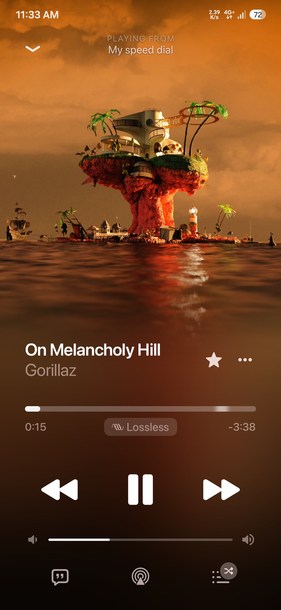
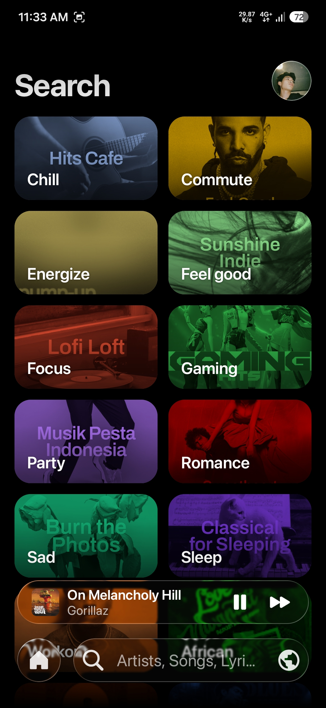
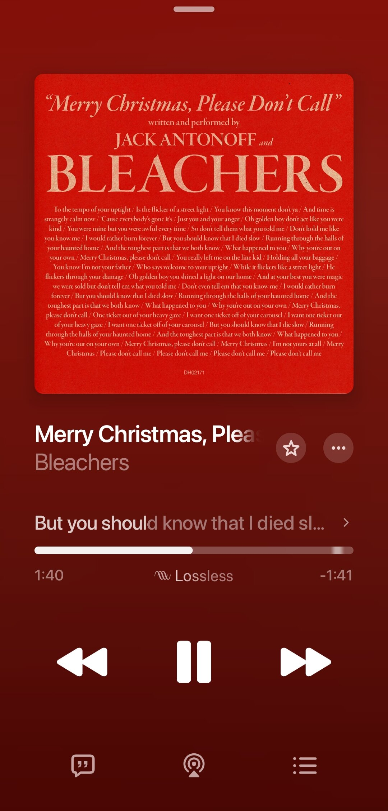

<div align="center">



<br />

<a href="https://github.com/Batmancpu/brrMusic/releases/latest"></a>
<a href="https://github.com/Batmancpu/brrMusic/releases"></a>


<a href="LICENSE"></a>

<br /><br />

<a href="https://github.com/Batmancpu/brrMusic/releases/latest"></a>
<a href="https://github.com/Batmancpu/brrMusic/issues"></a>

<br /><br />

**[Our sound](#our-sound)** · **[What makes it different](#what-makes-brrmusic-different)** · **[Install](#install)** · **[Roadmap](#the-road-ahead)** · **[Credits](#credits--acknowledgements)**

</div>

---

## Music, with more room to breathe.

**brrMusic** is an independent Android music-player fork built around the details that change how listening *feels*: a personal stereo soundstage, tighter platform integration, a clean visual identity, and updates that keep pace with upstream improvements.

It inherits a capable music experience from [Zenith](https://github.com/rezapranata089-bit/Zenith), which itself builds on [BitChord](https://github.com/kushagrasinghx/BitChord). The sections below put **brrMusic's additions first**, then explain what comes from upstream.

> [!NOTE]
> **A deliberately layered fork.** brrMusic's branding, audio integrations and release customizations live under `fc/` and are applied during the Android build. The tracked upstream app sources remain as close to Zenith as possible, helping us adopt fixes without carrying unnecessary long-lived source patches.

## Our sound

<table>
<tr>
<td width="50%" valign="top">

<h3>Adaptive Spatial Audio</h3>
<p><strong>More dimension. Less guesswork.</strong></p>
<p>A lightweight stereo widening and crossfeed engine with per-track preferences. When enabled, its automatic decision policy can use your <strong>explicit On/Off feedback</strong> to remember which tracks benefit from processing.</p>
<ul>
<li>On-device learning; no saved raw audio samples.</li>
<li>Per-track On/Off controls with Auto decision status.</li>
<li>Safety bypasses for unsuitable output paths and conflicting processing.</li>
</ul>
<p><a href="fc/spatial-audio/README.md">How the engine works</a></p>

</td>
<td width="50%" valign="top">

<h3>Refined audio path <sub>(experimental)</sub></h3>
<p><strong>Controlled, reversible iteration.</strong></p>
<p>Two optional audio-quality layers refine stereo width, crossfeed, center preservation and limiter behavior. Both are <strong>enabled in the current release configuration</strong> and can be rolled back independently.</p>
<ul>
<li>A gentler width/crossfeed profile and sample-rate-aware filtering.</li>
<li>Additional low-frequency side control and centered-signal preservation.</li>
<li>Automated DSP regression coverage across common sample rates.</li>
</ul>
<p><a href="fc/spatial-audio/experimental/README.md">Quality experiment</a> · <a href="fc/spatial-audio/refinement/README.md">Refinement details</a></p>

</td>
</tr>
</table>

> [!IMPORTANT]
> **Spatial Audio here means stereo soundstage processing**—not Dolby Atmos, object-based surround or personalized HRTF binaural rendering. The experimental limiter checks sample peaks, **not true peaks**. Automated tests establish behavior and numerical safety; they do not prove a subjective sound-quality improvement on every device.

## What makes brrMusic different

| Focus | What we've built or configured |
| :--- | :--- |
| **ColorOS integration** | Fluid Cloud compatibility is part of the brrMusic experience on supported ColorOS devices. Availability and appearance depend on the device, OS and integration support. |
| **A distinct identity** | brrMusic app label, Home presentation, share/replay branding, launcher treatment and release naming, applied through a reversible overlay. |
| **Personal spatial preferences** | Per-track manual choices inform a conservative on-device Auto policy; no behavioral assumptions from likes or playlists. |
| **A safer audio path** | Explicit speaker and competing-DSP bypass rules, with separate testable/reversible spatial-audio layers. |
| **Independent releases** | brrMusic-branded, versioned, signed APKs published from **this repository**, not a link to another fork's download page. |
| **Upstream without losing our work** | A dedicated synchronization and release workflow, plus fork-owned build-time patches intended to minimize direct edits to upstream application files. |

<details>
<summary><b>What you also get from Zenith and BitChord</b></summary>

<br />

The underlying player includes YouTube Music discovery and playback, local and downloaded music, synced lyrics, queues and playlists, personalized browsing, account and service integrations, customization, glass-style UI treatments and other playback controls. Some capabilities depend on provider accounts, optional modules, network access, device support or the particular upstream build.

Those are **inherited features**, not original brrMusic inventions. Explore [Zenith](https://github.com/rezapranata089-bit/Zenith) and [BitChord](https://github.com/kushagrasinghx/BitChord) for their broader feature histories and contributions.

</details>

## Made for the listening experience

The interface is based on Zenith's animated, artwork-led player. brrMusic adds its own presentation in the generated APK while keeping the underlying app architecture upstream-compatible.

<details>
<summary><b>Explore the inherited interface screenshots</b></summary>

<br />

These screenshots are inherited from Zenith. They illustrate the underlying interface; text, iconography and details in the **brrMusic APK can differ**.

<p align="center">
  
  
  
</p>

</details>

## Install

<div align="center">

<a href="https://github.com/Batmancpu/brrMusic/releases/latest"></a>

</div>

1. Open **[the latest brrMusic release](https://github.com/Batmancpu/brrMusic/releases/latest)**.
2. Download the `brrMusic-v*.apk` asset from this repository.
3. Install the APK on a compatible Android device. If Android prompts you, allow installation from that source.

| Requirement | Current release |
| :--- | :--- |
| Android | **8.0+** (API 26+) |
| Processor | **ARM64** (`arm64-v8a`) |
| Latest APK | [Releases](https://github.com/Batmancpu/brrMusic/releases) |
| Obtainium source | `https://github.com/Batmancpu/brrMusic` |

> [!CAUTION]
> The release build currently uses Android package ID **`com.spotify.music`**. It cannot be installed alongside another app using the same package name. If a package with a different signing certificate is already installed, Android may refuse the update; back up any data you need before uninstalling anything. brrMusic is **not Spotify** and is not affiliated with Spotify.

## Built to stay current

Our release process follows Zenith's upstream code while retaining the **brrMusic-specific** build overlays and signing identity.

- **Manual or push-triggered checks.** There is no promised background polling schedule; the sync workflow runs when invoked or when `main` is pushed.
- **Release gates.** Upstream compatibility checks, production unit tests, APK construction, package/version checks and signing verification must pass before publishing.
- **Conservative failure behavior.** An unresolved upstream conflict or incompatible overlay blocks a release rather than silently shipping a partially adapted build.
- **Reversible experiments.** The two optional audio layers can be disabled independently without renaming the Android package or changing its signing key.

For implementation details, see [fork integration notes](fc/README.md), [spatial audio design](fc/spatial-audio/README.md) and [GitHub Actions](.github/workflows/fc-sync-release.yml).

## The road ahead

Our goal is not a longer feature checklist. It is a music app that feels **more consistent, capable and carefully finished** with every release.

| Area | Direction | Status |
| :--- | :--- | :--- |
| **Spatial Audio** | Compare enabled/disabled audio with level-matched listening, device testing and intersample-peak checks. | **Validation needed** |
| **Audio performance** | Profile power use, glitches and latency across wired, Bluetooth and USB outputs before claiming measurable gains. | **To evaluate** |
| **ColorOS experience** | Verify Fluid Cloud behavior across eligible device and OS versions; improve fallbacks where practical. | **To evaluate** |
| **Visual identity** | Continue replacing inherited branding with polished brrMusic presentation without sacrificing mergeability. | **Ongoing** |
| **UI refinement** | Explore more coherent player surfaces, feedback states and achievement/title presentation where relevant. | **Exploration** |
| **Upstream resilience** | Keep integrations isolated, review changed upstream interfaces and expand regression coverage where failures recur. | **Ongoing** |

*These are priorities and exploration areas—not a promise of shipped functionality or release dates.*

## Development and transparency

brrMusic is a Kotlin-based Android project. The fork-specific integration is concentrated in these paths:

```text
fc/
├── branding/           Reversible brrMusic UI presentation
├── spatial-audio/      Spatial engine, learning and tests
│   ├── experimental/   Optional audio-quality experiment
│   └── refinement/     Optional center/limiter refinements
└── version.properties  Fork release metadata
.github/workflows/      Validation, upstream sync and publishing
```

To inspect or build from source, see the [repository files](https://github.com/Batmancpu/brrMusic), [integration notes](fc/README.md) and [Android build workflow](.github/workflows/build-apk.yml). Problems and feature proposals belong in [Issues](https://github.com/Batmancpu/brrMusic/issues).

> [!WARNING]
> brrMusic is a third-party client and is **not affiliated with or endorsed by** Google, YouTube, YouTube Music, Spotify, Dolby, OPPO or OnePlus. External services may change their interfaces or terms. Respect copyright, applicable platform terms and local law.

## License

Distributed under **[GNU GPL v3.0](LICENSE)**, in accordance with the repository's existing license. The licenses and attribution requirements of incorporated third-party components continue to apply.

---

## Credits & acknowledgements

**brrMusic stands on the work of people who built the foundations first.** Special thanks to:

1. **[Zenith](https://github.com/rezapranata089-bit/Zenith)** by **[rezapranata089-bit](https://github.com/rezapranata089-bit)** and its contributors — the **direct upstream fork** that provides the core app experience, visual system and much of the feature set.
2. **[BitChord](https://github.com/kushagrasinghx/BitChord)** by **[kushagrasinghx](https://github.com/kushagrasinghx)** and its contributors — the **earlier project in this fork's lineage**.
3. The developers and maintainers of underlying open-source projects and integrations, including the lyric-animation work of **[binimum](https://github.com/binimum/am-lyrics)**, **[Mochy Music](https://github.com/realidkroo/Mochy-Music)** by **[realidkroo](https://github.com/realidkroo)**, and the **[Mornye](https://github.com/mornyeapp/Mornye)** USB-audio reference cited by Zenith.

Their work makes this fork possible. **The brrMusic-specific contributions are additions to that shared foundation, not a replacement for its creators' credit.**
